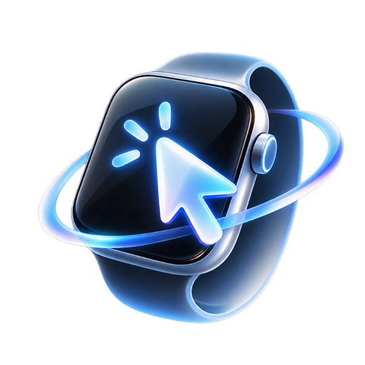
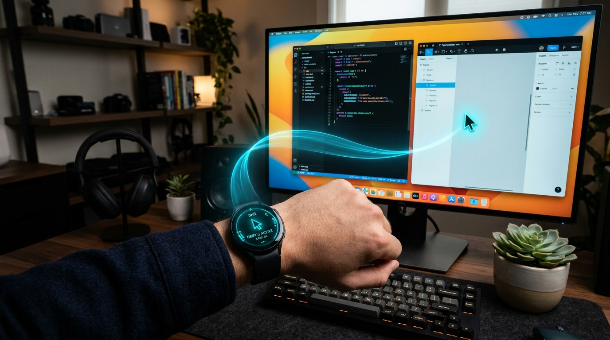
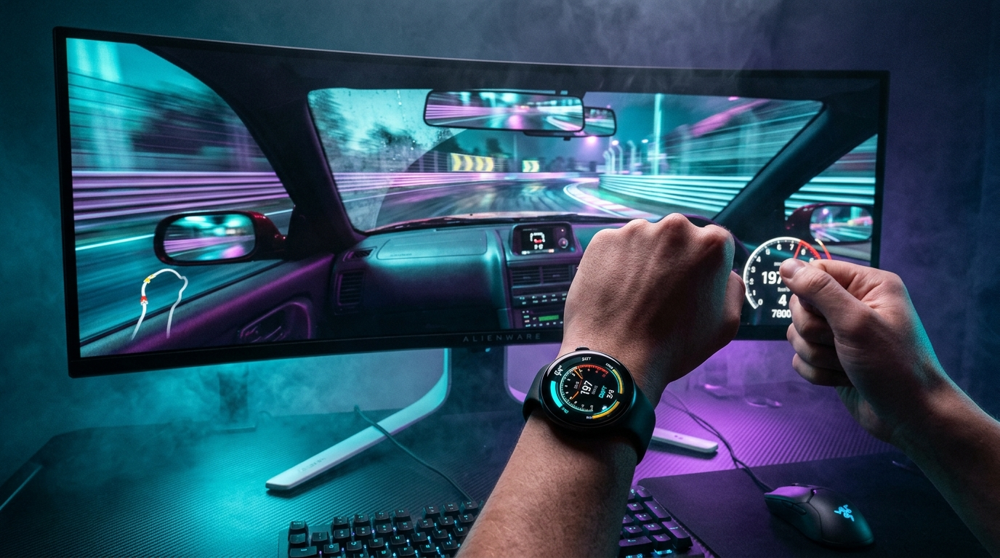
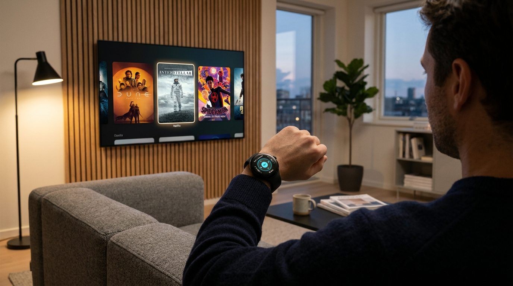
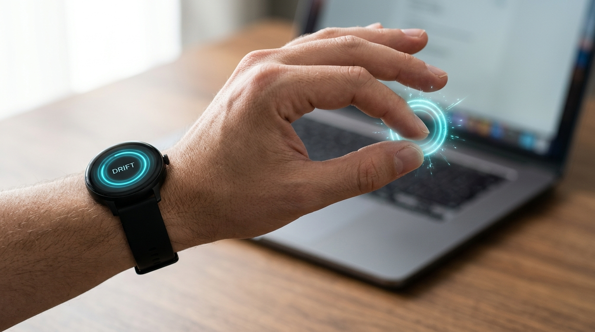

<div align="center">
  
  <h1>Drift</h1>
  <p><strong>Your wrist, your cursor.</strong></p>
  <p>Ultra-low-latency Wear OS Air Mouse, 1:1 Controller Gyroscope Steering Wheel, Trackpad, Smart TV Remote, and Presentation Clicker.</p>

  <p>
    <a href="LICENSE"></a>
    <a href="#build"></a>
    <a href="#connectivity-universal--driverless"></a>
    <a href="#wi-fi-companion--status-indicator-drift-receiver"></a>
  </p>
</div>

---

## Showcase

| Air Mouse & Fluid Aiming | 1:1 Controller Gyroscope Steering |
|:---:|:---:|
|  |  |
| **Tilt wrist to glide cursor · 1€ filter · Symmetric sub-pixel rounding** | **Virtual steering wheel · Instant cornering · Dedicated touch pedals** |

| Smart TV & Media Remote | Instant Precision Pinch Click |
|:---:|:---:|
|  |  |
| **D-Pad navigation · Rotating bezel volume · Works on Android TV / Fire TV** | **Sub-240ms jerk detection · Single pinch right-click · Double pinch left-click** |

---

## Connectivity: Universal & Driverless

Drift is designed to connect to any device instantly without friction.

| | Bluetooth HID (Recommended) | Wi-Fi Direct (Desktop Receiver) | Mac Screen Sharing (VNC) |
| --- | --- | --- | --- |
| **Driver / App on Host** | **None** (Native Bluetooth Mouse/Gamepad) | Drift Receiver (`.jar` or Mac `.app`) | **None** (Built-in macOS Sharing) |
| **Latency** | **Sub-10ms** (Real-time 100 Hz report delivery) | ~15ms (Low-latency UDP) | ~20ms (Standard RFB protocol) |
| **Supported Hosts** | macOS, Windows, Linux, iPadOS, iOS, Android, Android TV, Google TV, Fire TV | Windows, macOS, Linux | macOS |
| **Discovery** | Live scanning + 1-tap "Make watch discoverable" + BLE HID advertising | Automatic mDNS / UDP broadcast + manual IP entry | Bonjour LAN auto-discovery + manual IP |

---

## Operating Modes

Switch modes on the fly by tapping the mode pill at the top of the watch display:

### 1. Mouse (Air Mouse)
- **Fluid Motion**: Gyroscope angular velocity ($\text{rad/s}$) is processed through an adaptive **1€ filter** with dynamic cutoff scaling:
  - **Hover Precision**: Damps micro-tremor when aiming at small buttons or text targets.
  - **Zero-Lag Flicks**: Cutoff automatically increases to $30\text{--}60\,\text{Hz}$ during quick arm moves with zero phase lag.
  - **Symmetric Sub-Pixel Rounding**: Residual fractional coordinates are quantized with mid-tread rounding, eliminating direction reversal deadbands.
- **Click Actions**:
  - Single tap on screen = Left Click.
  - Double tap on screen = True Double Click.
  - Triple tap on screen = Right Click.
  - Screen touch freeze: Cursor position locks during taps to prevent target nudge.
- **Wrist Tilt Scroll**: Tilt wrist upward ($>15^\circ$) to scroll up; tilt wrist downward ($<-15^\circ$) to scroll down. Speed scales dynamically with tilt angle.
- **Rotating Bezel Scroll**: Spin the physical bezel clockwise or counterclockwise to scroll with haptic ticks.

### 2. Game (Controller Gyroscope Steering Wheel)
- **1:1 Steering Wheel Rotation**: 3D orientation vector projection calculates true forearm rotation angle relative to your calibrated neutral wrist position.
- **Zero-Latency Cornering**: High-cutoff 1€ filter provides instant turning response with rock-solid straightaway stability.
- **Physical Bezel Steering**: Adjust steering angle fine-tuning using the watch's rotating bezel.
- **Dedicated Touch Pedals**: Left pedal = Brake/Reverse, Right pedal = Gas/Throttle. Strict mutual exclusion ensures active braking completely overrides throttle.
- **Tactile Pause / Resume Button**: Symmetrical pause button opposite Settings halts sensor updates and sends `RemoteKey.ESCAPE` to open in-game pause menus.
- **Universal Game Compatibility**: Sends simultaneous Gamepad HID reports (Report ID 4) and keyboard WASD / arrow keys for instant out-of-the-box play on all PC and web racing games.

### 3. Touchpad
- Turns the entire AMOLED display into a high-precision multi-touch trackpad (gyroscope disabled).
- Single finger drag to move pointer, flick for inertia glide, single tap to click, hold to right-click, hold-and-drag to select/move items, two fingers to scroll.

### 4. TV Remote
- Full 4-way D-Pad ring with central OK button, Back, and Home.
- Physical rotating bezel controls volume up and down.
- Natively controls Android TV, Google TV, Apple TV, and Fire TV.

### 5. Media Controller
- Dedicated controls for Play / Pause, Next / Previous track, and Volume.
- Rotating bezel smoothly adjusts volume.

### 6. Keyboard & Dictation
- **Voice Dictation**: Tap Speak to transcribe voice directly into the active text field on your PC or Mac.
- **On-Screen Keyboard**: Type directly with Enter and Backspace keys.

### 7. Presentation Slides Remote
- Large Next and Back touch targets with distinct haptic buzz. Rotating bezel advances or steps back slides.

---

## Gestures Reference

| Gesture | How to Trigger | Default Action | Timing / Threshold |
| --- | --- | --- | --- |
| **Single Pinch** | Thumb meets index finger once | **Right Click** | Snappy sub-240ms dispatch |
| **Double Pinch** | Thumb meets index finger twice quickly | **Left Click** | 160–240ms inter-tap window |
| **Pinch & Hold** | Fingers meet and stay closed | **Drag / Hold Button** | Activates at 350ms hold; releases when fingers part |
| **Wrist Tilt Scroll** | Tilt wrist up or down | **Scroll Up / Down** | Active beyond $\pm 15^\circ$ tilt; auto-stabilizes cursor |
| **Wrist Shake** | Quick back-and-forth wrist swing | **Browser Back** | 4 rapid directional swings |
| **Double Knock** | Two sharp taps on watch case/wrist | **Configurable (Off)** | High-frequency casing impact jerk |
| **Pull-Pull** | Two quick backward arm retractions | **Configurable (Back)** | Linear acceleration along forearm axis |

*All gesture bindings and sensitivities can be customized in **Settings › Gestures**.*

---

## Wi-Fi Companion & Status Indicator (`receiver/`)

The repository includes **Drift Receiver**, an open-source companion app for computers on the same Wi-Fi network:

<div align="center">
  
</div>

### Features:
1. **Live Connection Indicator**: Displays connected watch name, IP address, port (`47800`), and connection health in real time.
2. **Explicit Authorization Gate**: When a new watch attempts to connect, the receiver displays an **Allow / Don't allow** prompt on your desktop screen. Unauthorized devices cannot control your cursor.
3. **High-Precision Robot Simulation**: Translates incoming motion datagrams into native OS mouse and keyboard events via `java.awt.Robot` with microsecond precision.
4. **Virtual Xbox Controller (`drift_vgamepad.py`)**: Includes a virtual gamepad bridge script using `vgamepad` that exposes Drift as an authentic Xbox 360 controller for PC racing games (Forza Horizon, Assetto Corsa, F1, BeamNG.drive).
5. **Standalone macOS App**: Built with an isolated Java runtime using `./receiver/package-mac.sh`—no external JRE installation required on your Mac.

### Wi-Fi Datagram Protocol:
UTF-8 text over UDP on port `47800`:
```
DRIFT? <model>                  # Broadcast search probe
DRIFT! <computer_name>          # Receiver announcement reply
HELLO <device_id> <model>       # Pair request
OK / WAIT / NO                  # Handshake responses
m <dx> <dy>                     # Relative pointer motion
click                           # Left button click (Down -> 35ms -> Up)
right                           # Right button click
double                          # True double click (Down -> Up -> 60ms -> Down -> Up)
down / up                       # Left button press and hold / release (drag)
s <steps>                       # Scroll wheel steps
wheel <steer> <gas> <brk> <ntr> # Game controller metrics (steer: -1.0..+1.0)
key <key_name>                  # Key press (next, prev, up, down, enter, esc, etc.)
BYE                             # Session teardown
```

---

## Pairing Guide

### Pairing over Bluetooth (PCs, Macs, TVs, Tablets):
1. Open **Drift** on the watch and tap **Go** (or **Settings › Connection**).
2. Under Bluetooth:
   - **From your PC/Mac/TV**: Tap **"Make watch discoverable"** on the watch. The watch becomes visible as "Drift" to all nearby devices for 3 minutes. Select it in your host's Bluetooth settings.
   - **From the watch**: Tap **"Scan again"** to discover nearby discoverable TVs, PCs, and tablets, then tap to pair directly from your wrist.
3. Once paired, Drift reconnects automatically whenever steering starts.

### Pairing over Wi-Fi (Drift Receiver):
1. Launch **Drift Receiver** on your PC or Mac.
2. In Drift on the watch, select **Wi-Fi** mode.
3. The watch automatically discovers your computer via mDNS / UDP broadcast. Tap **Go** and click **Allow** on your desktop.

### Pairing with Mac via Native Screen Sharing (VNC):
1. On your Mac, enable **System Settings › General › Sharing › Screen Sharing**.
2. In Drift on the watch, select your Mac from the Wi-Fi list and sign in with your macOS username and password (saved securely on the watch).
3. Drives your Mac directly with zero software installed on the computer.

---

## Building from Source

### Prerequisites:
- Android Studio Ladybug / Meerkat or later
- Android SDK 35 (Build Tools 35.0.0)
- JDK 17 or higher

### Build Watch App (`app`):
```bash
# Clone the repository
git clone https://github.com/your-username/drift.git
cd drift

# Run full unit test suite & screenshot verification
./gradlew testDebugUnitTest

# Assemble debug APK
./gradlew assembleDebug

# Install on connected watch via ADB
adb install -r app/build/outputs/apk/debug/app-debug.apk
```

### Build Desktop Receiver (`receiver`):
```bash
# Build runnable standalone JAR
./gradlew :receiver:jar

# Run the Receiver
java -jar receiver/build/libs/drift-receiver.jar

# Build native standalone macOS .app bundle
./receiver/package-mac.sh
```

---

## Project Structure

```
drift/
├── app/                                 # Wear OS App (Compose for Wear OS Material 3)
│   ├── src/main/java/com/drift/airmouse/
│   │   ├── core/                        # Service, MotionFilter, HidLink, VncLink, WifiLink, PinchDetector, AppPrefs
│   │   └── ui/                          # Compose Screens (HomeScreen, SteerScreen, DevicesScreen, SettingsScreen)
│   └── src/test/java/com/drift/airmouse/ # Unit tests & Roborazzi screenshot verification tests
├── receiver/                            # Desktop Companion Receiver (Kotlin / Swing Robot input)
│   ├── src/main/kotlin/com/drift/receiver/
│   └── drift_vgamepad.py               # Virtual Xbox / PlayStation gamepad bridge script
├── docs/                                # Documentation, Architecture Specs & Showcase Assets
│   ├── ARCHITECTURE.md                  # Comprehensive technical & mathematical specification
│   └── assets/                          # Product showcase graphics & logo
├── LICENSE                              # Apache License, Version 2.0
├── PRIVACY.md                           # Privacy policy documentation
└── TERMS.md                             # Terms of service documentation
```

---

## Open Source License

Drift is open-source software licensed under the **[Apache License, Version 2.0](LICENSE)**.

Contributions, bug reports, and pull requests are welcome!
